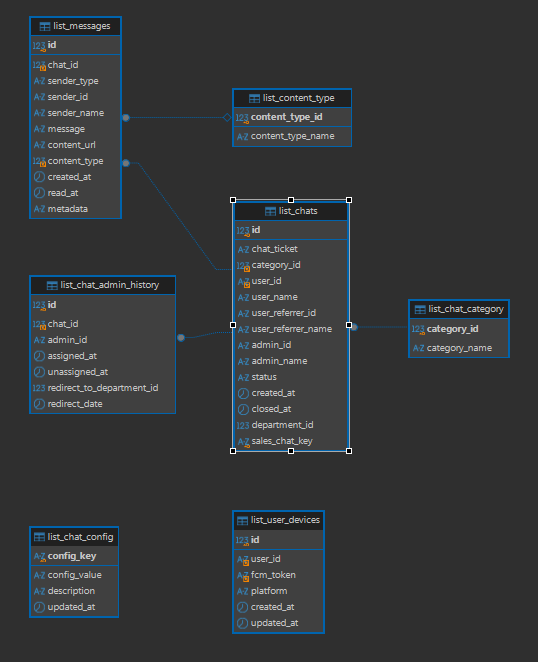

# Maxco Chat CS — Database Reference

For teams that read or fill this database directly, for example to move chat data from an older
system into this app. It describes the database created by the files in `sql/`. The same
structure in one runnable file, with the required reference rows: [`schema.sql`](schema.sql).

- Database name: `maxco_chat_im` (must match `MYSQLDATABASE` in `.env`), charset `utf8mb4`.
- Server: MySQL 8.0. MariaDB also works (tested on 10.4 and 10.11).
- Types and defaults below are shown as MySQL 8.0 reports them. MariaDB shows the same columns
  with display widths (`bigint(20)`, `int(11)`) and writes `current_timestamp()` for
  `CURRENT_TIMESTAMP`. `list_messages.metadata` is `longtext` holding JSON on both.

---

## 1. Overview

| Table | Holds |
|---|---|
| `list_chats` | One row per conversation between a member and the CS / Sales team |
| `list_messages` | Every message of every chat, text or file |
| `list_chat_admin_history` | Agent assignment history of a chat (not written by the current app, see §5) |
| `list_content_type` | Lookup: message types (1 = Text, 2 = File) |
| `list_chat_category` | Lookup: chat categories (1 = Customer Service, 2 = Announcement, 3 = Inside Sales) |
| `list_user_devices` | Push notification (FCM) tokens of members' phones |
| `list_chat_config` | Settings as key / value pairs |



The same links as text:

```text
 list_chat_category                          list_content_type
   category_id  <──────┐                ┌──────>  content_type_id
                       │                │
                  list_chats            │
                    id  <───────┬───────┼──────────────┐
                    category_id │       │              │
                                │  list_messages   list_chat_admin_history
                                │    chat_id          chat_id
                                │    content_type
                                │
 standalone:  list_user_devices (keyed by member user_id)
              list_chat_config  (keyed by config_key)
```

**Not in the database:**

- Members and agents. There is no users table: `user_id` is the member ID from the client's member
  system, `admin_id` is the CS / Sales person's ID from the CRM. Names are copied into the chat and
  message rows (`user_name`, `admin_name`, `sender_name`).
- Uploaded files. They are stored on disk in the `chat_uploads` volume; a file message only keeps
  the file's path (`list_messages.content_url`).
- Online status and "is typing". Kept in the app's memory only.

---

## 2. Tables

Null: `yes` = the column may be NULL. Default: `—` = no default (the value must be given on insert).

### `list_chats`

One row per conversation. A member can have several chats over time (one per category, and new
Customer Service chats after old ones are closed).

| Column | Type | Null | Default | Meaning |
|---|---|---|---|---|
| `id` | `bigint` | no | auto increment | Chat ID. Messages point to it. |
| `chat_ticket` | `varchar(50)` | yes | NULL | Ticket number shown to people, e.g. `K4ZQ-09B7-1A5C`; promotion chats hold the text `Promotion`. Format in §4. |
| `category_id` | `int` | no | — | Chat category, see `list_chat_category` (1 Customer Service, 2 Announcement, 3 Inside Sales). |
| `user_id` | `varchar(100)` | no | — | Member ID from the client's member system. |
| `user_name` | `varchar(100)` | yes | NULL | Member's display name when the chat was opened. |
| `user_referrer_id` | `varchar(100)` | yes | NULL | ID of the sales person the member belongs to (their referrer), as sent by the mobile app. Stored on Customer Service and Inside Sales chats; the Inside Sales chat is with this person, and the CRM's sales view lists chats by it. |
| `user_referrer_name` | `varchar(100)` | yes | NULL | Display name of that sales person. |
| `admin_id` | `varchar(100)` | yes | NULL | CRM ID of the CS / Sales person handling the chat. NULL while nobody has taken it. |
| `admin_name` | `varchar(100)` | yes | NULL | Display name of that person. |
| `status` | `enum('pending','active','closed')` | yes | `'pending'` | `pending` = waiting for an agent to take it; `active` = taken (Inside Sales and promotion chats start `active`); `closed` = finished. |
| `created_at` | `timestamp` | no | `CURRENT_TIMESTAMP` | When the chat was opened. |
| `closed_at` | `timestamp` | yes | NULL | When the chat was closed. NULL while open. |
| `department_id` | `int` | yes | NULL | Not used by the current app (§5). |
| `sales_chat_key` | `varchar(100)` | yes | generated | Computed by the database: `user_id` when `category_id = 3` and `status = 'active'`, otherwise NULL (`STORED`). Its unique key allows one **active** Inside Sales chat per member; closed ones are kept as history. Never insert or update it (§4). |

Keys and indexes:

- `PRIMARY` — `id`.
- `uq_list_chats_sales_chat` — unique on `sales_chat_key`: at most one **active** category 3 chat per
  `user_id`. NULLs do not collide, so categories 1 and 2, and closed or pending Inside Sales chats, are
  not limited by it.
- `FK_list_chats_list_chat_category` — foreign key `category_id` → `list_chat_category.category_id`,
  `ON UPDATE RESTRICT`, `ON DELETE RESTRICT` (a category in use cannot be renumbered or deleted).
- `idx_list_chats_user_id` — on `user_id` (chat list of one member).

### `list_messages`

Every message of every chat, oldest to newest by `created_at`, then `id`.

| Column | Type | Null | Default | Meaning |
|---|---|---|---|---|
| `id` | `bigint` | no | auto increment | Message ID. Breaks ties between messages with the same second in `created_at`. |
| `chat_id` | `bigint` | no | — | The chat, `list_chats.id`. |
| `sender_type` | `enum('user','admin','system')` | no | — | `user` = sent by the member (mobile app); `admin` = sent by CS / Sales (CRM); `system` = automated message written by the server when it closes an idle Customer Support chat (`metadata` `{"type":"auto_close"}`). |
| `sender_id` | `varchar(100)` | no | — | Member ID (when `user`), CRM ID (when `admin`), or `system`. |
| `sender_name` | `varchar(100)` | yes | NULL | Sender's display name at sending time. |
| `message` | `text` | yes | NULL | The text of a text message. |
| `content_url` | `text` | yes | NULL | File messages: path of the stored file, e.g. `uploads/chat/1763358000000_invoice.pdf`. NULL for text. |
| `content_type` | `int` | yes | NULL | Message type, see `list_content_type`: 1 = Text, 2 = File. Set it on every row: the CRM's message lists skip messages where it is NULL. |
| `created_at` | `timestamp` | no | `CURRENT_TIMESTAMP` | When the message was sent. |
| `read_at` | `timestamp` | yes | NULL | When the other side read it. NULL = unread. |
| `metadata` | `longtext` | yes | NULL | JSON (the database rejects text that is not valid JSON). File messages: `{"fileName": "...", "size": <bytes>}`. |

Keys and indexes:

- `PRIMARY` — `id`.
- `fk_message_chat` — foreign key `chat_id` → `list_chats.id` (update and delete restricted: a chat
  with messages cannot be deleted).
- `FK_list_messages_list_content_type` — foreign key `content_type` →
  `list_content_type.content_type_id`, `ON UPDATE CASCADE`, delete restricted.
- `idx_list_messages_chat_created` — on (`chat_id`, `created_at`, `id`) (message history page by page).

### `list_chat_admin_history`

Meant to record which agent handled a chat and when it was handed over. Kept from the earlier
version of the app; the current app neither writes nor reads it (§5).

| Column | Type | Null | Default | Meaning |
|---|---|---|---|---|
| `id` | `bigint` | no | auto increment | Row ID. |
| `chat_id` | `bigint` | no | — | The chat, `list_chats.id`. |
| `admin_id` | `varchar(100)` | no | — | CRM ID of the agent. |
| `assigned_at` | `timestamp` | no | `CURRENT_TIMESTAMP` | When the agent got the chat. |
| `unassigned_at` | `timestamp` | yes | NULL | When the agent stopped handling it. |
| `redirect_to_department_id` | `int` | yes | NULL | Department the chat was passed to. |
| `redirect_date` | `datetime` | yes | NULL | When it was passed on. |

Keys and indexes:

- `PRIMARY` — `id`.
- `fk_history_chat` — foreign key `chat_id` → `list_chats.id` (update and delete restricted).

### `list_content_type`

Lookup of message types. Its rows are required (§3).

| Column | Type | Null | Default | Meaning |
|---|---|---|---|---|
| `content_type_id` | `int` | no | auto increment | Type number used in `list_messages.content_type`. |
| `content_type_name` | `varchar(100)` | no | — | Type name. |

Keys and indexes:

- `PRIMARY` — `content_type_id`.

### `list_chat_category`

Lookup of chat categories. Its rows are required (§3).

| Column | Type | Null | Default | Meaning |
|---|---|---|---|---|
| `category_id` | `int` | no | auto increment | Category number used in `list_chats.category_id`. |
| `category_name` | `varchar(100)` | no | — | Category name. |

Keys and indexes:

- `PRIMARY` — `category_id`.

### `list_user_devices`

Firebase Cloud Messaging (FCM) tokens, one row per member device, used to send push notifications
for new chat messages. Not linked to the other tables by a foreign key.

| Column | Type | Null | Default | Meaning |
|---|---|---|---|---|
| `id` | `bigint` | no | auto increment | Row ID. |
| `user_id` | `varchar(100)` | no | — | Member ID (same as `list_chats.user_id`). |
| `fcm_token` | `varchar(1024)` | no | — | FCM registration token of one device. The app keeps each token on one member only: registering it again moves it. |
| `platform` | `varchar(20)` | no | `'android'` | Device platform as sent by the app, e.g. `android`, `ios`. |
| `created_at` | `timestamp` | no | `CURRENT_TIMESTAMP` | When the token was first registered. |
| `updated_at` | `timestamp` | no | `CURRENT_TIMESTAMP` | Set by the database on every change (`ON UPDATE CURRENT_TIMESTAMP`). |

Keys and indexes:

- `PRIMARY` — `id`.
- `idx_list_user_devices_user` — on `user_id`.
- `idx_list_user_devices_token` — on the first 191 characters of `fcm_token`.

### `list_chat_config`

App settings as key / value pairs. Its rows are required (§3).

| Column | Type | Null | Default | Meaning |
|---|---|---|---|---|
| `config_key` | `varchar(100)` | no | — | Setting name. |
| `config_value` | `varchar(255)` | no | — | Setting value, stored as text (numbers too). |
| `description` | `varchar(255)` | yes | NULL | What the setting does. |
| `updated_at` | `timestamp` | no | `CURRENT_TIMESTAMP` | Set by the database on every change (`ON UPDATE CURRENT_TIMESTAMP`). |

Keys and indexes:

- `PRIMARY` — `config_key`.

---

## 3. Reference data

These rows are created by the `sql/` files and must exist before the app (or an import) writes
chats and messages. The app uses the numbers directly, so keep the IDs exactly as below.

`list_content_type`:

| `content_type_id` | `content_type_name` |
|---|---|
| 1 | Text |
| 2 | File |

`list_chat_category`:

| `category_id` | `category_name` | Used for |
|---|---|---|
| 1 | Customer Service | Member ↔ CS chats. Opened by the member (or the CRM); starts `pending` until an agent takes it. |
| 2 | Announcement | Promotion chats opened by the CRM (`chat_ticket = 'Promotion'`). |
| 3 | Inside Sales | The member's chat with their sales person (`user_referrer_id`). One active chat per member. |

`list_chat_config`:

| `config_key` | `config_value` | Meaning |
|---|---|---|
| `max_waiting_minutes` | `120` | A `pending` or `active` chat whose last CS / Sales message is older than this many minutes, or that has no CS / Sales message yet, shows in the CRM's waiting list instead of its active list. |
| `auto_close_minutes` | `10` | `0` = off. Above `0`: a Customer Support chat whose last message is from CS and is at least this many minutes old (and at most this + 60) is closed automatically with a `system` message. Read every minute, no restart needed. |
| `auto_close_message` | `Hi {name}, since we haven't received …` | Text of that automated message; `{name}` = member name, `{minutes}` = `auto_close_minutes`. At most 255 characters. |

---

## 4. Rules for importing data

Some of these rules are enforced by the database (the insert fails); the others are only followed
by the app, so the database accepts rows that break them and the app then behaves wrongly.

1. **Order.** Reference data (§3) must exist first, then `list_chats`, then `list_messages` and
   `list_chat_admin_history`. Old chat IDs may be kept or renumbered, but every message's `chat_id`
   must point to its chat's `id` in this database. On a fresh install the next automatic IDs are
   46 (`list_chats`) and 211 (`list_messages`); after explicit IDs are inserted, numbering continues
   above the highest one.
2. **Inside Sales (category 3): one active chat per member.** Enforced by the database through
   `sales_chat_key`, which counts only `active` chats. A second `active` one fails with
   `ERROR 1062 (23000): Duplicate entry '<user_id>' for key 'list_chats.uq_list_chats_sales_chat'`.
   Import old ones as `closed` (with `closed_at` set) and at most one as `active`; the `active` one
   carries `user_referrer_id` / `user_referrer_name` and `admin_id` / `admin_name` of the member's
   sales person, because the CRM only opens `active` Inside Sales chats. A closed one does not block
   a new one from being created.
3. **Never write `sales_chat_key`.** The database computes it. Giving it a value fails with
   `ERROR 3105 (HY000): The value specified for generated column 'sales_chat_key' in table 'list_chats' is not allowed.`
   (MariaDB: `ERROR 1906`, or a silently ignored value outside strict SQL mode).
4. **Customer Service (category 1): import old conversations as `closed`**, with `closed_at` set.
   The database accepts open (`pending` / `active`) ones, but the app does not cope with many:
   - Every old open chat lands in the CRM waiting list (its last CS / Sales message is older than
     `max_waiting_minutes`), which is sorted oldest first. When an agent replies, the app only takes
     over (sets `active` and `admin_id` on) chats among the first 20 of that list, so 20 or more
     imported open chats stop new member chats from ever being taken over.
   - Keep at most one open category 1 chat per member: the mobile app reuses the member's newest
     open chat, while the CRM's current service chat for that member is their oldest waiting one,
     so with two open chats the member and the agent can end up in different chats.

   Import as open only the few chats that really are still open.
5. **Promotion (category 2): at most one `active` chat per member, `chat_ticket = 'Promotion'`.**
   Not enforced by the database.
6. **`chat_ticket`** for categories 1 and 3: 12 random characters (uppercase A–Z and 0–9) written
   as `XXXX-XXXX-XXXX` (e.g. `K4ZQ-09B7-1A5C`). The database does not require it to be unique, but people use it to
   refer to a chat, so keep it unique. Old ticket numbers may be kept if they fit in 50 characters.
7. **Text message:** `content_type = 1`, the text in `message`, `content_url` and `metadata` NULL.
8. **File message:** `content_type = 2`, `message` NULL,
   `content_url = 'uploads/chat/<epoch milliseconds>_<file name>'` (relative: no leading `/`, no
   host), `metadata = '{"fileName": "<file name>", "size": <bytes>}'`. Copy the file itself to
   `/app/uploads/chat/<epoch milliseconds>_<file name>` in the app container (for example
   `docker cp <file> <app container>:/app/uploads/chat/`); that is `chat/...` at the root of the
   `chat_uploads` volume, which is mounted at `/app/uploads`. The app serves it at
   `<app base URL>/uploads/chat/...`. Files that only exist at an old URL (old server,
   cloud storage) must be downloaded, stored this way and their URL rewritten; full URLs in
   `content_url` are not what the app and its clients are built for.
9. **`metadata` must be valid JSON or NULL.** Anything else fails with
   `ERROR 3819 (HY000): Check constraint 'list_messages_chk_1' is violated.` (MariaDB: `ERROR 4025`).
10. **Sender:** `sender_type = 'user'` with the member ID in `sender_id`, or `sender_type = 'admin'`
    with the CRM ID; `sender_name` = display name. Do not import `system`: only the server writes it.
11. **Read state:** `read_at` NULL means unread. The mobile app's unread badge counts `admin` and `system`
    messages with `read_at` NULL, so set `read_at` (for example to the message's `created_at`) on
    old messages that should not show as unread.
12. **Time zone.** The time columns are `timestamp`: the database stores them in UTC and converts
    them from and to the time zone of each connection (`@@session.time_zone`). The app sets its
    own connections to UTC (`+00:00`), so the server time zone does not change what it reads or
    writes. An import connection uses the server default unless told otherwise: either leave it at
    the server default and give server-local times, or run
    `SET time_zone = '+00:00';` first and give UTC times (dumps made by mysqldump or HeidiSQL do
    this themselves). Check from the import connection with
    `SELECT @@session.time_zone, @@global.time_zone, @@system_time_zone, NOW();`. Times in the wrong
    zone shift every chat, and the CRM waiting list (§3, `max_waiting_minutes`) compares them with
    the current time. `list_chat_admin_history.redirect_date` is `datetime` and is not converted.
13. **Referrer:** set `user_referrer_id` / `user_referrer_name` on category 1 and 3 chats to the
    member's sales person. The CRM's sales view lists chats by `user_referrer_id`, so chats without
    it do not show there.

---

## 5. Columns the app does not write

Kept from the earlier version of the app. The current app never writes or reads them, so they can
be filled from old data or left empty:

- `list_chats.department_id`
- the whole `list_chat_admin_history` table (`chat_id`, `admin_id`, `assigned_at`,
  `unassigned_at`, `redirect_to_department_id`, `redirect_date`). If it is filled, its `chat_id`
  must exist in `list_chats` (foreign key).
