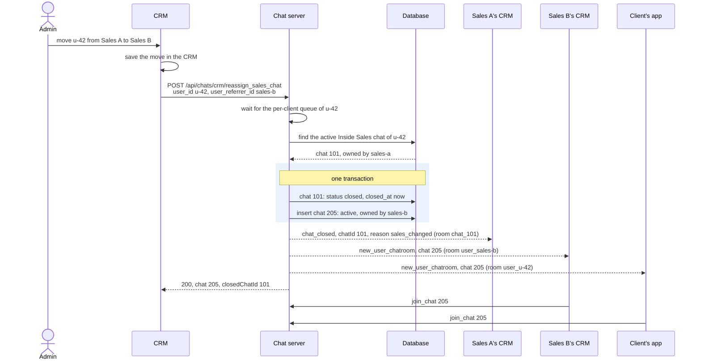
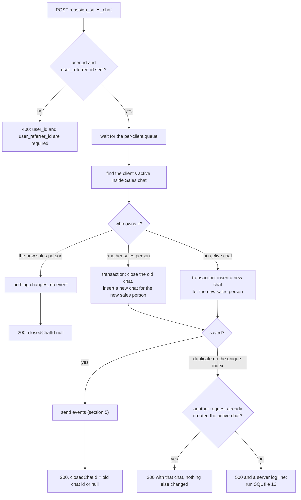
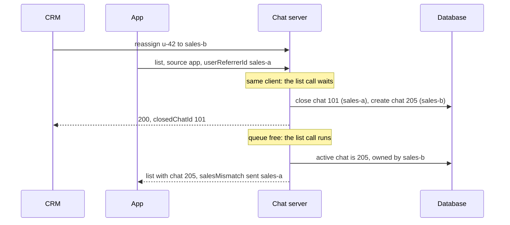
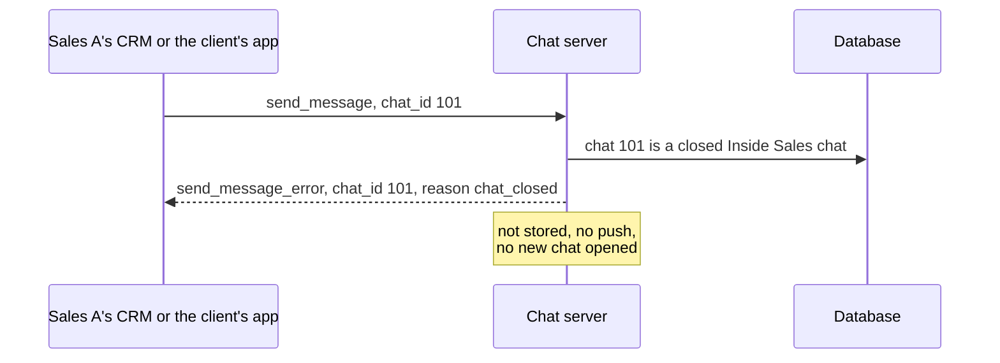
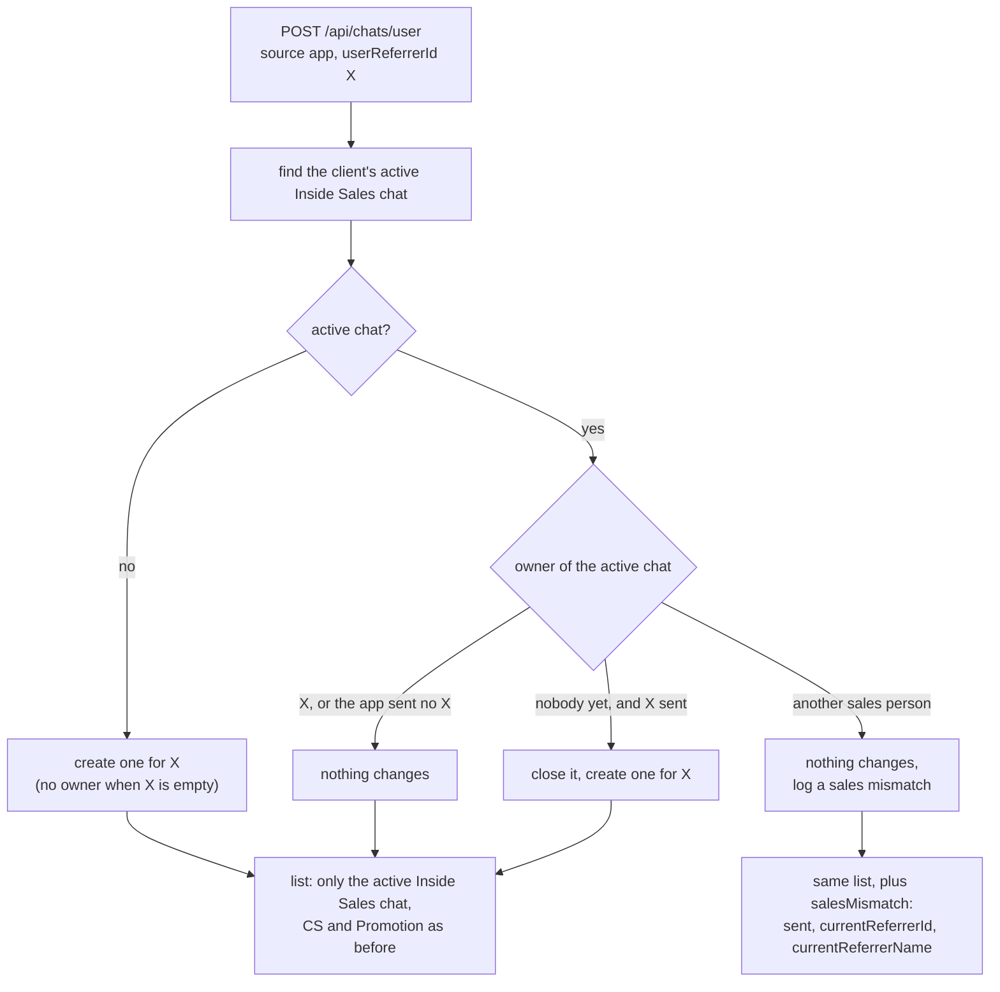
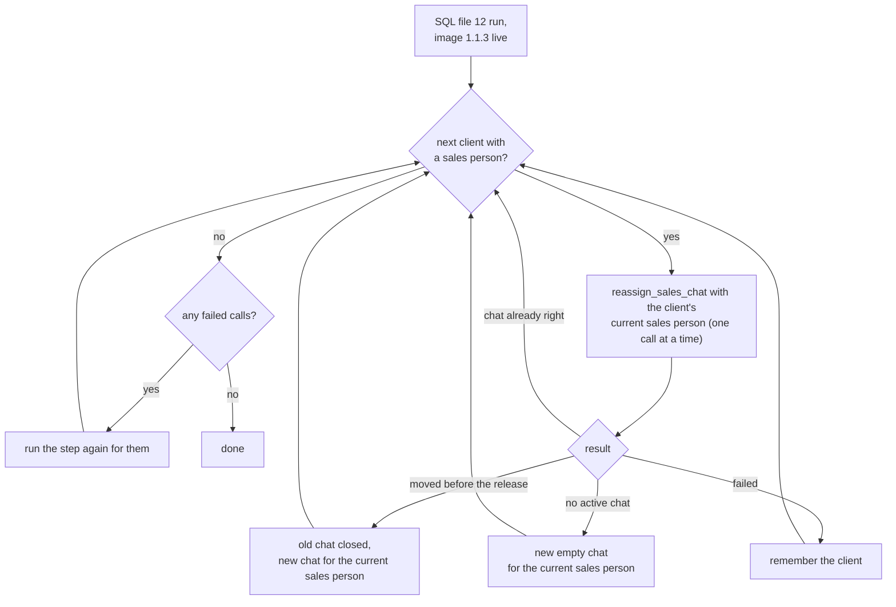
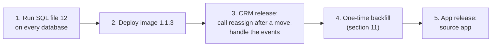

# Sales Chat Reassign Flow (Developers)

How the server moves a client's Inside Sales chat (`category_id = 3`) to a new sales person: the code path, the data, the events, concurrency and failure modes.

- **Plain-language version** (admin, sales, PM): `docs/sales-chat-reassign-flow.md`.
- **What each team builds:** `docs/integration-guide-sales-chat-crm.md` and `docs/integration-guide-sales-chat-app.md`.
- **Shipped in:** PR #20, image `maxco-chat-cs:1.1.3`, SQL file `12_dbchanges_202611241200.sql`.

**Rule:** a client has at most one **active** Inside Sales chat. Older ones are **closed** and kept with their messages. Nothing is deleted. Only `POST /api/chats/crm/reassign_sales_chat` moves a client to another sales person.

## 1. The rule in the database

`list_chats` has a generated column and a unique index on it (`deploy/schema.sql`, SQL file 12):

```sql
sales_chat_key varchar(100) GENERATED ALWAYS AS
  (CASE WHEN category_id = 3 AND status = 'active' THEN user_id ELSE NULL END) STORED,
UNIQUE KEY uq_list_chats_sales_chat (sales_chat_key)
```

An active Inside Sales chat puts its `user_id` in the key; every other row puts `NULL`, which a unique index ignores. So the database itself refuses a second active Inside Sales chat for the same client, while closed ones pile up freely. Before SQL file 12 the key ignored `status`, so a closed chat still blocked a new one.

Client `u-42` moved from `sales-a` to `sales-b`:

| `id` | `user_id` | `category_id` | `status` | `user_referrer_id` | `admin_id` | `sales_chat_key` | `closed_at` |
|---|---|---|---|---|---|---|---|
| **Before** | | | | | | | |
| 101 | u-42 | 3 | active | sales-a | sales-a | u-42 | NULL |
| **After** | | | | | | | |
| 101 | u-42 | 3 | closed | sales-a | sales-a | NULL | 2026-11-24 07:00:00 |
| 205 | u-42 | 3 | active | sales-b | sales-b | u-42 | NULL |

The messages of chat 101 in `list_messages` are not touched. Chat 205 gets a new `chat_ticket` and starts empty.

## 2. Code path

```text
POST /api/chats/crm/reassign_sales_chat                    src/routes/chatRoutes.ts
  crmChatController.reassignSalesChat                      400 when user_id or user_referrer_id is empty
    salesChatService.reassignSalesChat                     trims the ids and names
      withSalesChatLock(userId)                            per-client queue (section 6)
        crmChatService.findAnyActiveInsideSalesChat        the active category 3 chat, or null
        owner == new sales person  ->  { chat, closedChatId: null }, no event
        replaceSalesChat(userId, userName, sales, current, notifyUser = true)
          closeAndInsert                                   BEGIN
                                                             UPDATE list_chats SET status='closed', closed_at=NOW()
                                                               WHERE id = current.id AND status = 'active'
                                                             INSERT list_chats (... 'active', 3, sales ...)
                                                           COMMIT (ROLLBACK on any error)
          on ER_DUP_ENTRY: findAnyActiveInsideSalesChat + isOtherWriterWinner (section 6)
          getChatById(new id), getChatById(closed id)      plain rows for the payloads
          emit chat_closed, new_user_chatroom x2           after COMMIT only
```

Files: [crmChatController.ts](../src/controllers/crmChatController.ts) (`reassignSalesChat`), [salesChatService.ts](../src/services/salesChatService.ts) (`withSalesChatLock`, `closeAndInsert`, `replaceSalesChat`, `reassignSalesChat`, `isOtherWriterWinner`), [crmChatService.ts](../src/services/crmChatService.ts) (`findAnyActiveInsideSalesChat`).

## 3. The whole flow



## 4. What the server decides



| Status | Body |
|---|---|
| `200` | `{ success: true, data: { chat, closedChatId }, message: "Inside sales chat is with the new sales person" }` |
| `400` | `{ success: false, message: "user_id and user_referrer_id are required" }` |
| `500` | `{ success: false, message: "Internal server error" }` |

## 5. Events

Sent only after `COMMIT`, and only when something changed. `chatData` is the plain `list_chats` row from `getChatById`.

| Event | Room | Payload | Receiver |
|---|---|---|---|
| `chat_closed` | `chat_<old id>` | `{ chatId, chatData, reason: "sales_changed" }` | Old sales person's CRM; the client's app if it has the old chat open. Only when a chat was closed. |
| `new_user_chatroom` | `user_<new sales person id>` | `{ chatData }` | New sales person's CRM (joined with `join_user`). |
| `new_user_chatroom` | `user_<client id>` | `{ chatData }` | The client's app (joined with `join_user`). |

`new_user_chatroom` is also sent for new CS and Promotion chats, and by "Chat with Client". Receivers check `chatData.category_id`.

## 6. Concurrency

Two layers:

1. **Per-client queue** (`withSalesChatLock`): a promise chain per `user_id`, the same pattern as `supportChatQueues`. The reassign, the app list call (`ensureAppSalesChat`) and the legacy list call (`ensureUserSalesChat`) all run inside it, so they never decide on the same stale "active chat". A failed task does not block the next one. It lives in memory in one Node process.
2. **Unique index** `uq_list_chats_sales_chat`: the real guarantee, also across processes. A second active chat fails with `ER_DUP_ENTRY`, and the whole transaction rolls back (the old chat's close included).



**After `ER_DUP_ENTRY`** (`isOtherWriterWinner(current, winner)`), the server reads the active chat again:

| Active chat found | Meaning | Result |
|---|---|---|
| a chat other than the one it tried to close | another writer (another process, or "Chat with Client", which runs outside the queue) created it first | `200` with that chat, no event |
| the chat it tried to close, or none | the old index (closed chats count) is still in place: SQL file 12 was not run | log `Run sql/dbchanges_202611241200.sql ...`, throw, `500` |

## 7. Messages to a closed Inside Sales chat



- `chatService.sendMessage` calls `routeMessage`, which throws `ChatClosedError` for a closed category 3 chat, whoever sends and however it was closed.
- `insertMessageIfOpen` stores the message only while the chat is open (`NOT (category_id IN (1,3) AND status = 'closed')`). When a reassign closes the chat between routing and insert, it returns `null`, `routeMessage` runs again and throws.
- `src/sockets/sendMessageErrors.ts` turns `ChatClosedError` into `send_message_error { chat_id, reason: "chat_closed" }`, sent to the sending socket only.
- Closed CS tickets differ: a user message opens a new ticket. Closed Promotion chats still store messages.

## 8. The app's list call

`POST /api/chats/user` (`chatController.getUserSalesChat`). With `"source": "app"` it runs `ensureAppSalesChat`, then `fetchUserChats(..., { activeSalesOnly: true })`, which adds `AND (category_id <> 3 OR status = 'active')`.



- "create one for X" calls `replaceSalesChat(..., null, notifyUser = false)`: the app gets the chat in the response, so only the sales person gets `new_user_chatroom`.
- "close it, create one for X" calls `replaceSalesChat(..., current, notifyUser = true)`: same events as a reassign.
- The mismatch log line: `sales mismatch: user <id> sent sales <X>, chat <id> belongs to <owner>`.

**Without `source`** (old app versions): `ensureUserSalesChat` creates a chat only when the client has no category 3 chat at all, closed ones included, and the list holds every chat. Unchanged from before.

## 9. Other paths that touch sales chats

| Path | Behavior |
|---|---|
| "Chat with Client" (`POST /api/chats/crm/open_inside_sales_chat`, `crmChatService.openInsideSalesChat`) | Unchanged and outside the queue. Reuses the active chat of the logged-in sales person, else inserts one; on `ER_DUP_ENTRY` it returns the existing active chat, even another sales person's. After a chat is closed by hand, it opens the next active chat. |
| Unread count (`GET /api/client/chat/unread/:userId`, `clientChatService.getClientChatUnread`) | Leaves closed Inside Sales chats out of `chats` and `total`, so the badge clears after a move. |
| Referred list (`POST /api/chats/crm/chat/referred`) | Unchanged: every status, so the old sales person keeps the closed chat. Send `categoryIds: [3]`: without it the list holds only Customer Support chats. |
| `GET /api/chats/user/:userId` | Unchanged: every chat, closed Inside Sales chats included. |

## 10. Failure modes

| Situation | What happens | Fix |
|---|---|---|
| Image deployed before SQL file 12 | Reassign answers `500`, log says run SQL file 12. CS and Promotion work. | Run SQL file 12. |
| CRM call fails (network, `5xx`) | The client keeps chatting with the old sales person. | CRM retries; the call is safe to repeat. After a `5xx`, reload: it may have been saved. |
| App sends an out-of-date sales person | Nothing changes; `salesMismatch` in the response, a line in the server log. | CRM reassign, or the app refreshes its user data. |
| SQL file 11 run again after a reassign | File 11 merges sales chats only while its index is missing, so the closed and the active chat stay apart. | Nothing; `run-sql.sh` re-runs 11 and 12 safely. |
| Several server processes | The queue is per process; the unique index still keeps one active chat, and `ER_DUP_ENTRY` resolves to the winner. | Nothing today (one container). |

## 11. One-time backfill



## 12. Release order



## 13. Tests

`npm run test:db` (needs the database in `.env.local`):

| File | Covers |
|---|---|
| `test-db/sales-chat-reassign.test.ts` | move A to B with events, no chat yet, only a closed chat, already B, `400`, two reassigns at once, a chat that appeared meanwhile wins |
| `test-db/sales-chat-app.test.ts` | `source: "app"`: same sales person, `salesMismatch`, empty or padded ids, create, ownerless chat replaced, closed chats hidden, app load and reassign at once; legacy path without `source` |
| `test-db/sales-chat-lock.test.ts` | `withSalesChatLock`: tasks of one client never overlap, a failed task does not block the next |
| `test-db/sales-chat-closed-send.test.ts` | sends to a closed Inside Sales chat refused for both sides, `insertMessageIfOpen` stores nothing; active chat and closed Promotion still store |
| `test-db/migration-12.test.ts` | file 12 runs twice, closed and active chats coexist, two active ones cannot, file 11 re-run after 12 keeps chats apart |

`npm test` (no database): `test/chat/sales-chat-duplicate.test.ts` covers `isOtherWriterWinner` (another writer won, or the old index is in place).
