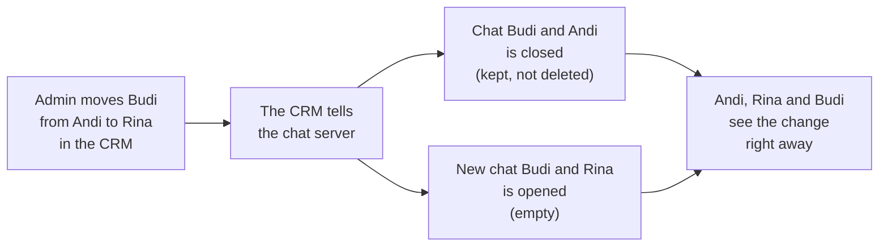
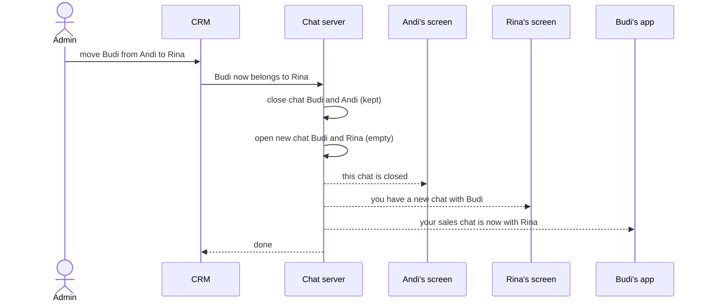
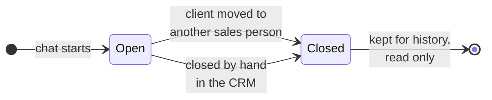
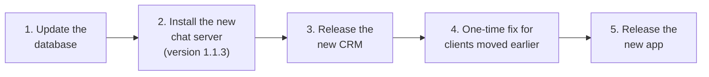

# How Moving a Client to a New Sales Person Works

When admin moves a client to a new sales person in the CRM, the client's sales chat moves too:

- The chat with the **old** sales person is **closed**. It is kept, not deleted.
- A **new, empty** chat opens between the client and the **new** sales person.
- From then on, the client talks only to the new sales person.

The examples below use one client, **Budi**, who is moved from sales person **Andi** to sales person **Rina**.

## 1. The idea in one picture



## 2. Step by step

1. **Admin moves Budi** from Andi to Rina in the CRM, the same way as today.
2. **The CRM tells the chat server** about the move. This happens automatically; admin does nothing extra.
3. **The chat server closes the old chat** between Budi and Andi. Every message in it is kept.
4. **The chat server opens a new chat** between Budi and Rina. It starts empty.
5. **Everyone's screen updates right away**, without reloading:
   - Andi sees the old chat as closed and can no longer type in it.
   - Rina sees the new chat with Budi appear in Rina's chat list.
   - Budi's app shows the new chat with Rina instead of the old one.



## 3. What each person sees after the move

| Person | Before the move | After the move |
|---|---|---|
| **Andi** (old sales person) | Chat with Budi, open | Same chat, now **closed**. Andi can read it but not write in it. |
| **Rina** (new sales person) | No chat with Budi | A **new, empty** chat with Budi. Rina cannot see what Budi and Andi wrote. |
| **Budi** (client) | Chat with Andi | Only the **new** chat with Rina. The old chat no longer shows in the app. |
| **Admin** | | Nothing extra to do. |

What Budi's app looks like:

```
 Before the move                          After the move
┌ Live Chat ─────────────────────┐       ┌ Live Chat ─────────────────────┐
│ Customer Support               │       │ Customer Support               │
│ Promotion                      │       │ Promotion                      │
│ Andi (Sales)   See you Monday  │  ──►  │ Rina (Sales)   no messages yet │
└────────────────────────────────┘       └────────────────────────────────┘
```

Customer Support and Promotion chats do not change.

## 4. Life of a sales chat



- A client has **only one open** sales chat at a time.
- A closed sales chat is **never reopened**. Messages sent to it are refused, from either side.
- A client can collect several closed sales chats over time, one for each earlier sales person.

## 5. Common questions

**Is the old conversation deleted?**
No. It stays on the server, and the old sales person can still read it in their list, marked as closed.

**Can the new sales person read the old conversation?**
No. The new sales person starts with an empty chat.

**Can the old sales person still send a message to the client?**
No. The old chat is closed. A message typed there is refused and does not reach the client.

**What happens if the move is done twice?**
Nothing. If Budi already chats with Rina, moving Budi to Rina again changes nothing.

**What if the CRM cannot reach the chat server at that moment?**
The CRM tries again. Until it gets through, Budi keeps chatting with Andi.

**What if Budi's app still thinks the sales person is Andi?**
The app does not move clients; only the CRM does. Budi stays with Rina. The app gets a warning that its information is out of date, and nothing breaks.

**What if a client was moved before this update went live?**
Right after the update goes live, the CRM runs a one-time fix that puts every client's chat with their current sales person.

**What about clients using an old version of the app?**
They still see the old, closed chat in their list, but they cannot send messages in it. Updating the app fixes the list.

**Is a sales chat closed by hand reopened later?**
No. When the sales person uses "Chat with Client" again, a new chat opens.

## 6. Going live



The order matters: the database update must be done before the new chat server is installed, or moving a client fails.

## For developers

The technical version of this flow (code path, data, events, concurrency, failure modes) is `docs/sales-chat-reassign-flow-dev.md`. What each team builds is in the integration guides:

- **CRM:** `docs/integration-guide-sales-chat-crm.md`. It covers the `POST /api/chats/crm/reassign_sales_chat` call, the `chat_closed` (`reason: "sales_changed"`) and `new_user_chatroom` events, retries and the one-time fix.
- **App:** `docs/integration-guide-sales-chat-app.md`. It covers `POST /api/chats/user` with `source: "app"`, `salesMismatch`, the events and refused messages.
- **Database:** SQL file `12_dbchanges_202611241200.sql` makes the "one open sales chat per client" rule count only open chats.
